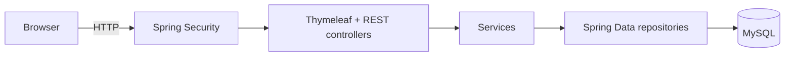

# Java Resume Management System

A Spring Boot web application for maintaining a personal resume. Skills, projects, and education are stored in MySQL and rendered through Thymeleaf; an authenticated admin can manage skills and projects from a dashboard or through REST endpoints.

## Features

- Public resume page at `/` rendered from database content.
- Admin login with Spring Security and a BCrypt-hashed password.
- Admin dashboard with counts of skills and projects.
- Create, read, update, and delete skills.
- Create, read, update, and delete projects.
- REST APIs for skills and projects, available to the admin.
- Automatic schema creation/update through Hibernate.
- Server-rendered Thymeleaf templates with a custom stylesheet.

## Tech stack

| Layer | Technology |
| --- | --- |
| Language | Java 21 |
| Framework | Spring Boot 4.1.0, Spring MVC |
| Security | Spring Security, BCrypt, form login, CSRF protection |
| Persistence | Spring Data JPA, Hibernate, MySQL 8 |
| View | Thymeleaf, HTML, CSS |
| Build | Maven Wrapper (`mvnw` / `mvnw.cmd`) |
| Tests | Spring Boot Test with in-memory H2 |

## Architecture



- `/`, `/login`, and static assets are public.
- `/admin/**` and `/api/**` require the `ADMIN` role.
- The public resume reads data through the same services used by the admin screens.

## Project structure

```text
src/main/java/resume/
├── ResumeApplication.java
├── ResumeController.java
├── config/SecurityConfig.java
├── controller/             # admin, login, skill/project REST controllers
├── entity/                 # Skill, Project, Education
├── repository/             # Spring Data JPA repositories
└── service/                # skill, project, education services
src/main/resources/
├── application.properties
├── static/css/style.css
└── templates/              # resume, login, and admin pages
src/test/                   # context-load test with H2
```

## Prerequisites

- JDK 21
- MySQL 8+
- No global Maven installation is required; the wrapper is included.

## Setup (Windows PowerShell)

### 1. Create the database

```powershell
mysql -u root -p -e "CREATE DATABASE IF NOT EXISTS resume_db;"
```

### 2. Configure environment variables

`.env.example` is a reference only; Spring Boot does not read it automatically. Export the values in the shell that starts the application:

```powershell
$env:DB_URL="jdbc:mysql://localhost:3306/resume_db"
$env:DB_USERNAME="root"
$env:DB_PASSWORD="your-mysql-password"
$env:ADMIN_USERNAME="admin"
$env:ADMIN_PASSWORD="choose-a-strong-password"
```

If `ADMIN_USERNAME` / `ADMIN_PASSWORD` are omitted, local development falls back to `admin` / `admin123`.

### 3. Run the application

```powershell
cd java-resume-management-system
.\mvnw.cmd spring-boot:run
```

Open <http://localhost:8080/> for the public resume and <http://localhost:8080/login> for the admin login.

The database starts empty. Sign in as admin, add skills and projects, and the public resume page will render them.

## Configuration

| Variable | Default | Purpose |
| --- | --- | --- |
| `DB_URL` | `jdbc:mysql://localhost:3306/resume_db` | MySQL JDBC URL |
| `DB_USERNAME` | `root` | MySQL user |
| `DB_PASSWORD` | empty | MySQL password |
| `ADMIN_USERNAME` | `admin` | In-memory admin username |
| `ADMIN_PASSWORD` | `admin123` | In-memory admin password |

## Routes and API

| Method | Path | Access | Purpose |
| --- | --- | --- | --- |
| GET | `/` | Public | Render the resume |
| GET | `/login` | Public | Admin login form |
| GET | `/admin` | Admin | Dashboard |
| GET | `/admin/skills`, `/admin/projects` | Admin | Management lists |
| POST | `/admin/skills/save`, `/admin/projects/save` | Admin | Create records |
| POST | `/admin/skills/update/{id}`, `/admin/projects/update/{id}` | Admin | Update records |
| GET | `/admin/skills/delete/{id}`, `/admin/projects/delete/{id}` | Admin | Delete records |
| GET | `/api/skills` | Admin | List skills |
| GET | `/api/skills/{id}` | Admin | Get one skill |
| POST | `/api/skills` | Admin | Create a skill |
| PUT | `/api/skills/{id}` | Admin | Update a skill |
| DELETE | `/api/skills/{id}` | Admin | Delete a skill |
| GET | `/api/projects` | Admin | List projects |
| GET | `/api/projects/{id}` | Admin | Get one project |
| POST | `/api/projects` | Admin | Create a project |
| PUT | `/api/projects/{id}` | Admin | Update a project |
| DELETE | `/api/projects/{id}` | Admin | Delete a project |

The REST endpoints use the same form-login session; they are not a separate token API. Unauthenticated requests are redirected to `/login` or rejected by Spring Security.

## Data model

| Entity | Table | Fields |
| --- | --- | --- |
| `Skill` | `skills` | `id`, `name`, `category` |
| `Project` | `projects` | `id`, `title`, `technologies`, `description` |
| `Education` | `education` | `id`, `degree`, `college`, `year`, `percentage` |

Education records are rendered on the resume but do not have admin CRUD screens yet; they must be inserted directly in the database.

## Testing

```powershell
.\mvnw.cmd test
```

Tests run against in-memory H2 (`src/test/resources/application.properties`) and do not require MySQL. The current suite is a context-load test; last verified **1 test, 0 failures** (2026-10-28).

## Security notes

- The admin password is hashed with BCrypt at startup.
- Credentials are read from environment variables; only local-development defaults are committed.
- CSRF protection is enabled. The Thymeleaf forms use `th:action`, which adds the CSRF token automatically.
- There is no public registration and no second role.
- This is a learning project, not a production identity system: one in-memory admin, no password rotation, no audit log, no rate limiting, and no HTTPS configuration. Terminate TLS at a reverse proxy and set strong credentials before exposing it.

## Known limitations

- No seed data; the resume is empty until records are added.
- No pagination, search, or image uploads.
- No Flyway/Liquibase migrations; Hibernate manages the schema with `ddl-auto=update`.
- No Dockerfile or deployment configuration.
- No license file is included. Ask before redistributing.
